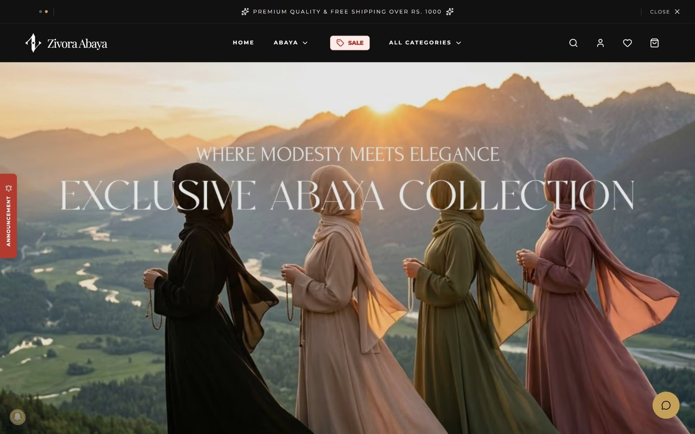
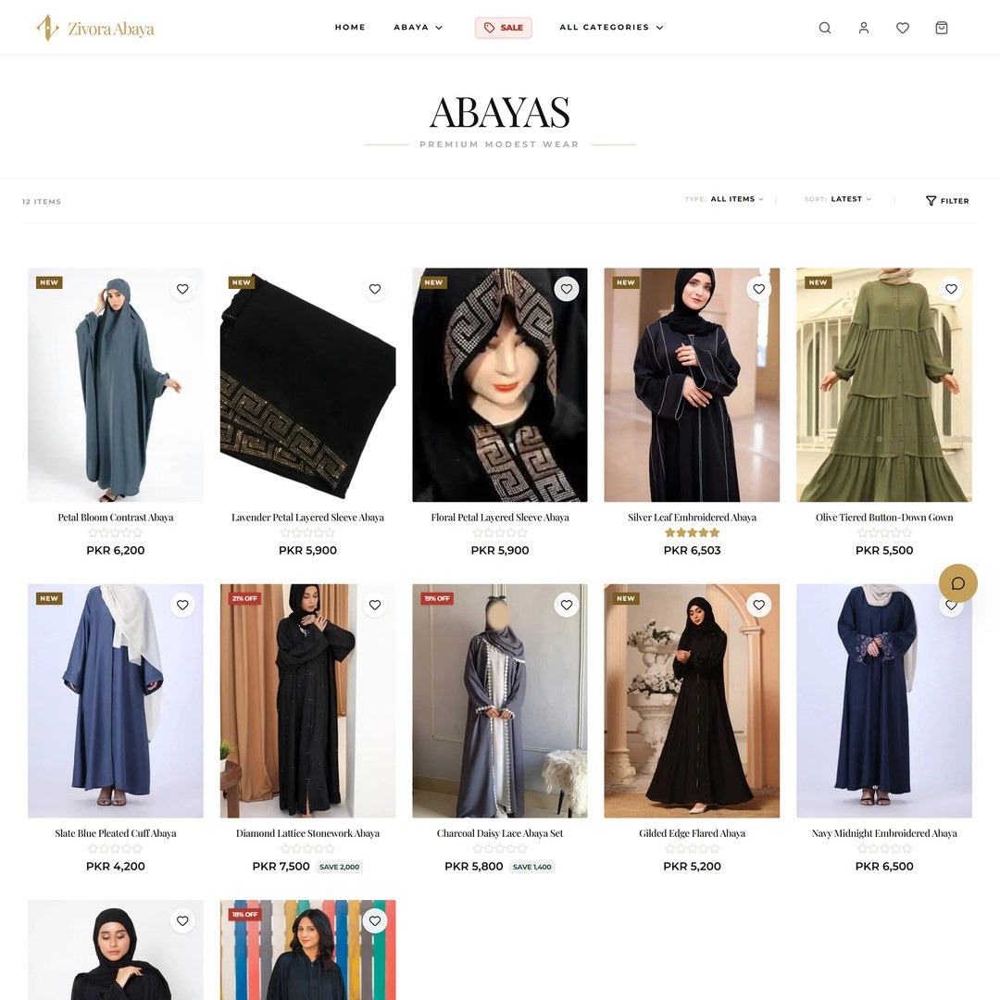
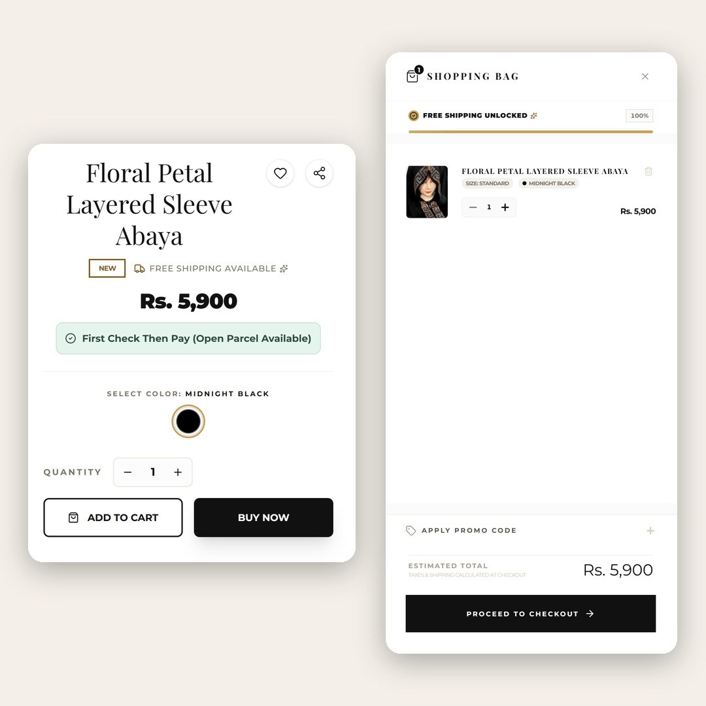
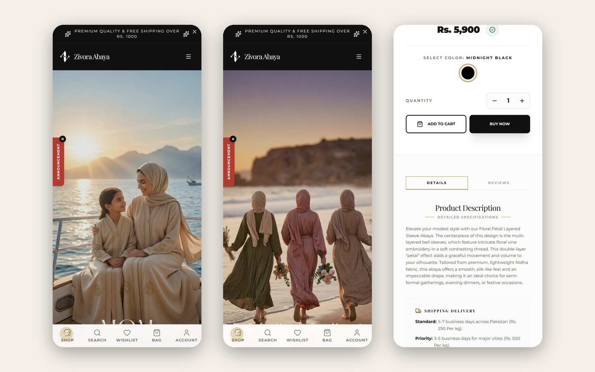

# Zivora Abaya

An online store for abayas, hijabs, shawls and accessories, built for the Pakistani market with Next.js, TypeScript and Firebase. It's a mobile-first e-commerce website with its own admin panel, and it installs on your phone like an app (PWA).

**[Open the live site](https://zivora-abaya.vercel.app/)**

## What's in it

**For shoppers**

- **Storefront:** hero carousel, collection and category pages, sorting and filters, search, sale badges and "Complete the Look" suggestions
- **Product pages:** colour, size and quantity options, size guide, reviews with photos, delivery and returns info
- **Cart and checkout:** slide-out cart, free-shipping progress bar, promo codes, and cash on delivery with a "check then pay" option
- **Accounts:** sign in with email or Google, wishlist, order history and order tracking
- **On a phone:** bottom navigation, quick add on product cards, installable as an app

**For the store owner**

- An admin panel to manage products and variants, categories, orders and tracking, coupons and promotions, announcements, hero and banner images, reviews and size charts
- Team roles (admin and editor)
- Orders export to PDF and Excel

<table>
  <tr>
    <td width="50%"></td>
    <td width="50%"></td>
  </tr>
</table>

## How it's put together

Pages are Next.js routes. Data lives in Firestore and is read and written through a services layer, with typed converters. Cart and wishlist state sits in Zustand stores, with React context providers on top. Server routes handle image uploads to Cloudinary and push notifications through OneSignal. The admin panel is for signed-in admin and editor accounts.

The full folder map is in [docs/PROJECT-STRUCTURE.md](docs/PROJECT-STRUCTURE.md).

## Something I fixed along the way

Once the main features worked, I went through the code looking for what would fail with real customers. The worst find was a race condition in the cart: two quick updates could overwrite each other. That's fixed, and guest carts now carry over when someone logs in.

## Built with

Next.js 16, React 19, TypeScript and Tailwind CSS 4, with shadcn/ui and Framer Motion. Firebase (Firestore and Authentication) for data and sign-in, Cloudinary for images, OneSignal for web push notifications, Zustand for client state. Hosted on Vercel.

## Environment variables

The app needs Firebase, Cloudinary and OneSignal keys. [.env.example](.env.example) lists every variable the code reads, with empty values. Real values are never committed.

## Still in progress

I'm still working on it: new UI and UX, and more features. Each round goes into the [changelog](CHANGELOG.md), and I write about the before and after on LinkedIn.

<!--
Uncomment this once the first LinkedIn post is published, and add a bullet for every new post:

## Write-ups

- [Post title](https://www.linkedin.com/posts/...)
-->

## Source code

The code is in a private repository. If you'd like a walkthrough, message me on [LinkedIn](https://www.linkedin.com/in/abidhussainsoftware/).

## About me

I'm Abid Hussain, a full-stack developer based in Karachi, Pakistan.
